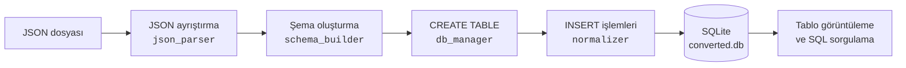
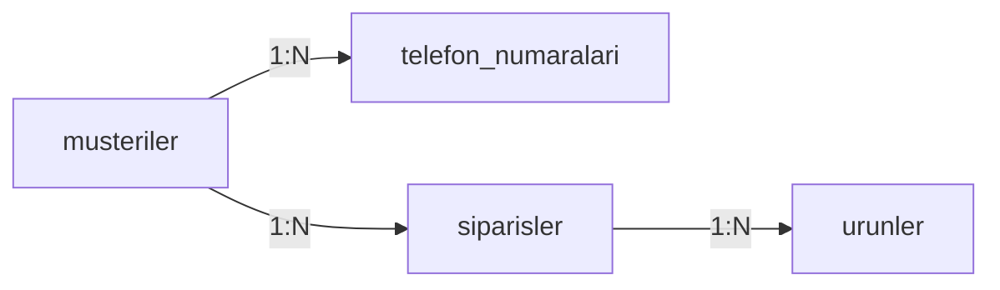

<div align="center">

# NoSQL → SQL Dönüşüm Sistemi

**İç içe JSON verilerini otomatik olarak ilişkisel bir SQLite veritabanına dönüştüren masaüstü uygulaması.**

JSON dosyanı seç, tek tıkla şemayı üret, tabloları incele ve SQL sorguları çalıştır.


</div>

## İçindekiler

- [Özellikler](#özellikler)
- [Nasıl çalışır?](#nasıl-çalışır)
- [Örnek dönüşüm](#örnek-dönüşüm)
- [Kurulum](#kurulum)
- [Kullanım](#kullanım)
- [Dönüşüm kuralları](#dönüşüm-kuralları)
- [Proje yapısı](#proje-yapısı)
- [Testler](#testler)
- [Bilinen sınırlamalar](#bilinen-sınırlamalar)

## Özellikler

- **Otomatik şema çıkarımı:** Tablolar, sütunlar ve veri tipleri JSON içeriğinden üretilir; elle şema yazmak gerekmez.
- **Düzleştirme:** İç içe objeler tek tabloda sütunlara açılır (`adres.sehir` → `adres_sehir`).
- **Otomatik normalizasyon:** Nesne ve ilkel değer dizileri ayrı alt tablolara taşınır, `FOREIGN KEY` ile üst tabloya bağlanır.
- **Çok katmanlı yapı desteği:** 6 seviye derinliğe kadar iç içe diziler test edilmiştir.
- **Görsel inceleme:** JSON ağacı, tablo verileri ve üretilen `CREATE TABLE` komutları aynı ekranda görüntülenir.
- **Sorgu ekranı:** Oluşturulan veritabanında `SELECT` sorguları çalıştırılabilir.
- **Sıfır kurulum:** Yalnızca Python standart kütüphanesi kullanılır.

## Nasıl çalışır?



1. Şema oluşturucu tüm kayıtları tarayarak düzleştirilmiş sütunları ve alt tabloları belirler.
2. Her sütunun tipi, o sütundaki tüm değerlere bakılarak seçilir.
3. Tablolar, üst tablolar önce gelecek şekilde oluşturulur.
4. Normalizer kayıtları `INSERT` işlemlerine çevirir; üst kayıtların gerçek `id` değerleri ekleme sırasında alt kayıtlara aktarılır.

## Örnek dönüşüm

`musteriler.json` dosyası:

```json
[
  {
    "ad": "Ayşe",
    "soyad": "Yılmaz",
    "yas": 30,
    "aktif": true,
    "adres": { "sehir": "Kocaeli", "ilce": "İzmit" },
    "telefon_numaralari": [{ "tip": "cep", "numara": "555-0101" }],
    "siparisler": [
      {
        "siparis_no": "S-1001",
        "toplam": 150.5,
        "urunler": [
          { "urun_adi": "Kalem", "adet": 2, "fiyat": 25.25 },
          { "urun_adi": "Defter", "adet": 1, "fiyat": 100.0 }
        ]
      }
    ]
  },
  {
    "ad": "Mehmet",
    "soyad": "Demir",
    "yas": 41,
    "aktif": false,
    "adres": { "sehir": "Ankara", "ilce": "Çankaya" },
    "telefon_numaralari": [{ "tip": "ev", "numara": "555-0102" }],
    "siparisler": [
      {
        "siparis_no": "S-1002",
        "toplam": 75.0,
        "urunler": [{ "urun_adi": "Silgi", "adet": 3, "fiyat": 25.0 }]
      }
    ]
  }
]
```

Bu dosyadan 4 tablo ve 9 satır üretilir:



| Tablo | Sütunlar | Foreign key |
| --- | --- | --- |
| `musteriler` | `id`, `ad`, `soyad`, `yas`, `aktif`, `adres_sehir`, `adres_ilce` | Yok |
| `telefon_numaralari` | `id`, `musteriler_id`, `tip`, `numara` | `musteriler_id` → `musteriler.id` |
| `siparisler` | `id`, `musteriler_id`, `siparis_no`, `toplam` | `musteriler_id` → `musteriler.id` |
| `urunler` | `id`, `siparisler_id`, `urun_adi`, `adet`, `fiyat` | `siparisler_id` → `siparisler.id` |

Tablolar artık standart SQL ile birleştirilebilir:

```sql
SELECT m.ad, s.siparis_no, u.urun_adi, u.adet
FROM musteriler m
JOIN siparisler s ON s.musteriler_id = m.id
JOIN urunler u ON u.siparisler_id = s.id;
```

| ad | siparis_no | urun_adi | adet |
| --- | --- | --- | --- |
| Ayşe | S-1001 | Kalem | 2 |
| Ayşe | S-1001 | Defter | 1 |
| Mehmet | S-1002 | Silgi | 3 |

## Kurulum

**Gereksinimler:** Python 3.10 veya üzeri, Tkinter desteği.

```bash
git clone https://github.com/slanur/nosql-to-sql-converter.git
cd nosql-to-sql-converter
python3 main.py
```

Windows'ta `python3` yerine `python` kullanın.

Tkinter çoğu Python kurulumunda hazır gelir. `No module named 'tkinter'` hatası alırsanız:

```bash
# Debian / Ubuntu
sudo apt install python3-tk
```

```bash
# macOS (Homebrew)
brew install python-tk
```

## Kullanım

1. **Dosya Seç** ile bir `.json` dosyası yükleyin. Yapı sol paneldeki ağaçta görünür.
2. **Dönüştür** butonuna basın. Yapılan işlemler ortadaki günlükte listelenir.
3. Sağ panelde tablo seçin ve sekmeler arasında gezin:
   - **Veri:** Tablonun satırları
   - **SQL Şeması:** Tablonun `CREATE TABLE` komutu
   - **SQL Sorgula:** Kendi sorgularınız (`Ctrl+Enter` ile çalıştırılır)
4. Yeni bir dosya denemek için **Sıfırla** ile tüm tabloları temizleyin.

> [!WARNING]
> Her **Dönüştür** işlemi `converted.db` içindeki mevcut tabloların tamamını siler. Veritabanı, uygulamanın başlatıldığı klasörde oluşturulur. Saklamak istediğiniz sonuçları başka bir yere kopyalayın.

> [!NOTE]
> Sorgu ekranı yalnızca `SELECT` ile başlayan tek bir ifadeyi çalıştırır. `WITH` ile başlayan sorgular da reddedilir.

## Dönüşüm kuralları

| JSON | SQL karşılığı |
| --- | --- |
| Kök nesne veya nesne listesi | Dosya adını taşıyan ana tablo |
| İç içe nesne | Üst alan adıyla birleşen sütunlar (`adres_sehir`) |
| Nesne dizisi | Dizi adını taşıyan alt tablo ve `<üst_tablo>_id` foreign key'i |
| İlkel dizi (`["a", "b"]`) | Değerleri `deger` sütununda tutan alt tablo |
| Farklı yerlerde aynı dizi adı | Çakışan tablo `<üst_tablo>_<dizi>` adını alır (`projeler_kisiler`) |
| `id` veya `<üst_tablo>_id` adlı alan | `kaynak_` önekiyle saklanır (`kaynak_id`) |
| `string` | `TEXT` |
| Tam sayı | `INTEGER` |
| Ondalıklı sayı | `REAL` |
| `true` / `false` | `INTEGER` (`1` / `0`) |
| `null` | `NULL` |
| Aynı alanda karışık tipler | Baskın tip: `TEXT` > `REAL` > `INTEGER` |

Her tabloya otomatik artan bir `id` birincil anahtarı eklenir. Tablo ve sütun adları küçük harfe çevrilir, harf/rakam dışındaki karakterler `_` ile değiştirilir. Veri aktarımı sırasında foreign key denetimi etkindir.

## Proje yapısı

```text
nosql-to-sql-converter/
├── main.py                 # Uygulama girişi ve dönüşüm akışı
├── parser/
│   ├── json_parser.py      # JSON okuma ve yapı analizi
│   └── flattener.py        # İç içe objeleri düzleştirme
├── engine/
│   ├── schema_builder.py   # Tablo ve sütun şemasını üretme
│   └── normalizer.py       # INSERT işlemlerini üretme
├── database/
│   └── db_manager.py       # SQLite bağlantısı ve sorgular
├── utils/
│   └── type_mapper.py      # Python tipi → SQL tipi eşlemesi
├── tests/
│   └── test_conversion.py  # Dönüşüm testleri
└── ui/
    ├── json_panel.py       # JSON ağacı paneli
    ├── control_panel.py    # Dönüştür/Sıfırla ve işlem günlüğü
    ├── sql_panel.py        # Tablo, şema ve sorgu sekmeleri
    └── styles.py           # Tema renkleri ve stiller
```

## Testler

Dönüşüm motorunun testleri standart kütüphaneyle çalışır:

```bash
python3 tests/test_conversion.py
```

## Bilinen sınırlamalar

| Durum | Sonuç |
| --- | --- |
| İki alan aynı sütun adına dönüşüyor (`Ad` ve `ad`, ya da `a_b` ve `a.b`) | Tek sütun oluşur ve son değer kalır; diğer değer hata vermeden kaybolur. |
| Tam sayı, SQLite'ın 64 bitlik aralığını aşıyor | Dönüşüm `Python int too large to convert to SQLite INTEGER` hatasıyla durur. |
| Dizi adı `sqlite_` ile başlıyor | Dönüşüm `object name reserved for internal use` hatasıyla durur. |

---

<div align="center">

Kocaeli Üniversitesi

</div>
